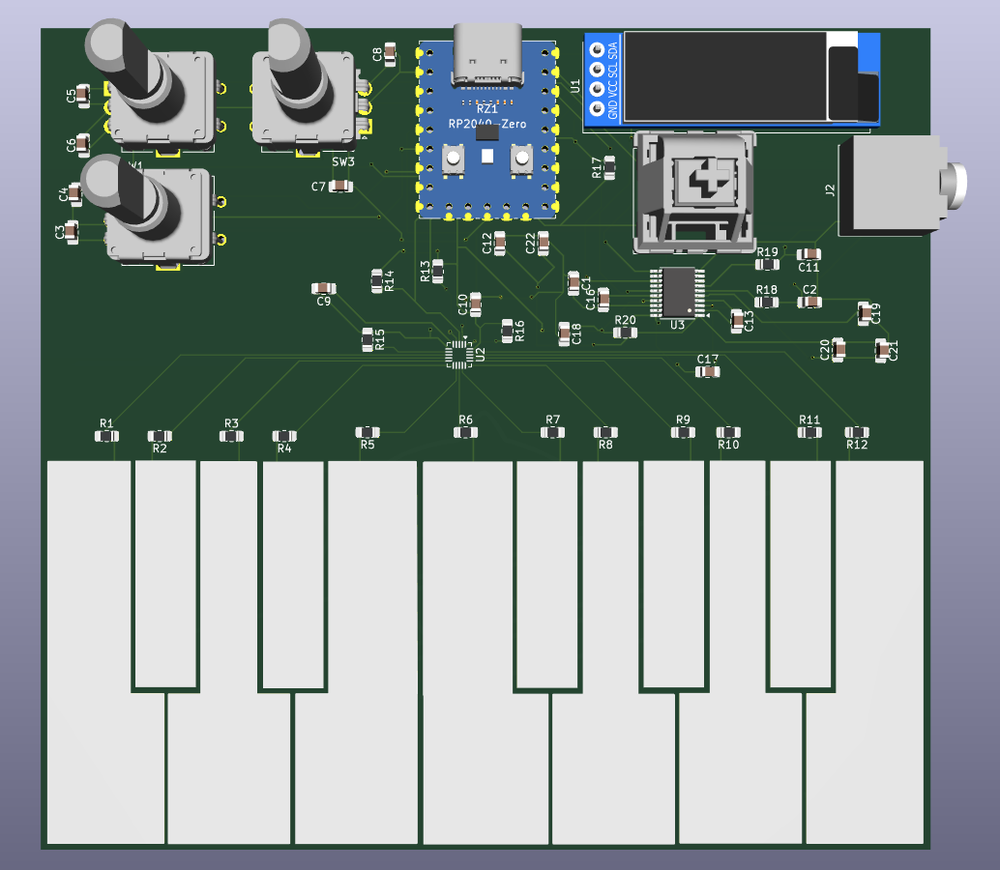
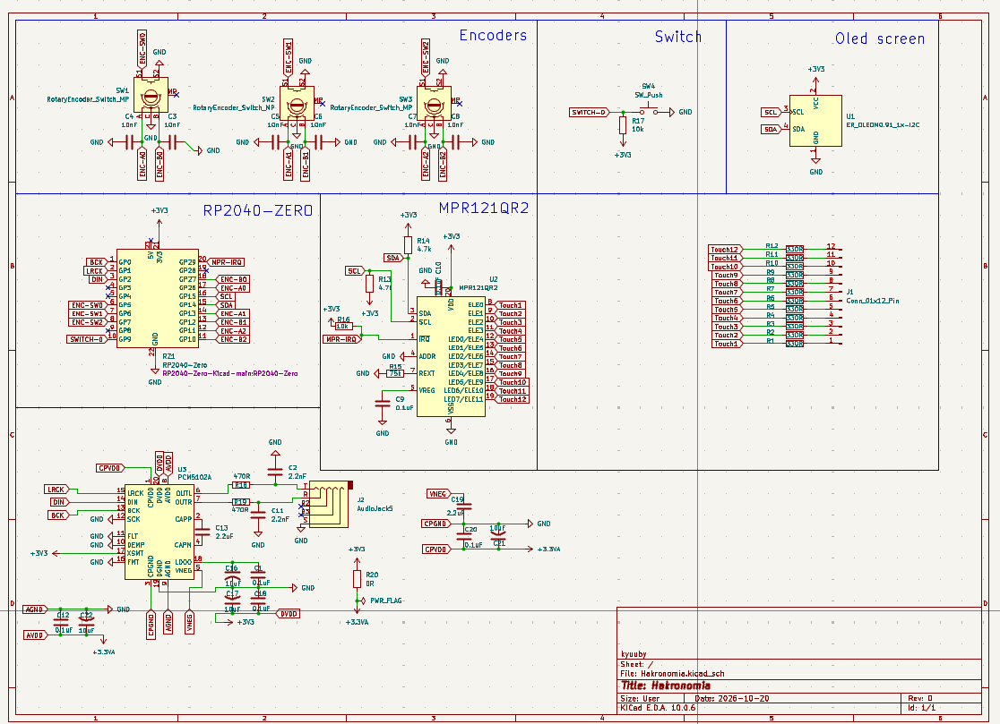

# Hakronomia

<!--START_SECTION:BOM-TABLE-->
| Item | Qty | Supplier | Cost/item | Total Cost | link |
| --- | --- | --- | --- | --- | --- |
| Estimated total shipping | 1 |  | $0.00 | $0.00 |  |
| Estimated total shipping | 1 |  |  | $5282.00 |  |
<!--END_SECTION:BOM-TABLE-->
# HOW TO INSTALL THE FIRMWARE (Hakronomia.py):

1)    Connect your RP2040-ZERO to your PC using a data transfer cable while pressing BOOT 

2)    Install/Copy the "adafruit-ciruitpython-waveshare" file i put in this folder ON the RP2040-ZERO.

3)    you should see file be downloaded on your microcontroller.

4)    From CircuitPython libraries bundle, copy "adafruit_mpr121, adafruit_displayio_ssd1306, adafruit_display_text, adafruit_bus_device" on the rp2040-zero.

5)    Copy Hakronomia.py on the rp2040-zero

# What is Hakronomia?
Hakronomia, Midi keyboard, it's a Piano style keyboard an it has 12 exposed copper plates keys, plus 3 rotary encoder, a 0.91 inch screen, a switch and a 3.5mm AudioJack.
It uses a MPR121QR2 ( The MPR121QR2 is a Capacitive Touch Sensor Controller )  and the PCM5102A ( DAC Chip (Digital-to-Analog Converter ).

## Physical view:

## PCB view:

## Schematic view:

 
