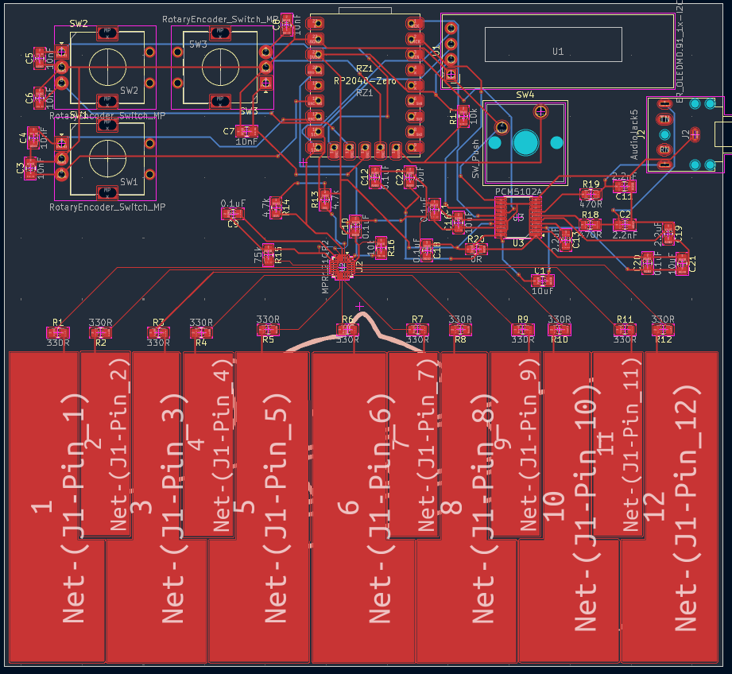

# Hakronomia

<!--START_SECTION:BOM-TABLE-->
| Product name | Producer | Order Qty. | Unit Price(USD) | Ext.Price(USD) | Vendor | Product Link										 |
| --- | --- | --- | --- | --- | --- | --- |
| MPR121QR2 | NXP | 1 | 2.6105 | 2.61 | LCSC | [Link](https://www.lcsc.com/product-detail/C91322.html) |
| HRC0805J472 FNTN | HWA CHN | 100 | 0.0015 | 0.15 | LCSC | [Link](https://www.lcsc.com/product-detail/C55098665.html) |
| CC0805ZRY5V6BB225 | YAGEO | 20 | 0.0345 | 0.69 | LCSC | [Link](https://www.lcsc.com/product-detail/C520072.html) |
| 1N4007 | MSKSEMI | 100 | 0.0081 | 0.81 | LCSC | [Link](https://www.lcsc.com/product-detail/C7528875.html) |
| 0805 ±5% 75K | VO | 100 | 0.0031 | 0.31 | LCSC | [Link](https://www.lcsc.com/product-detail/C2889622.html) |
| FRC0805F4701TS | FOJAN | 100 | 0.0022 | 0.22 | LCSC | [Link](https://www.lcsc.com/product-detail/C2907264.html) |
| RT0805BRD0710KL | YAGEO | 20 | 0.0371 | 0.74 | LCSC | [Link](https://www.lcsc.com/product-detail/C110775.html) |
| CC0805FRNPO9BN100 | YAGEO | 20 | 0.0369 | 0.74 | LCSC | [Link](https://www.lcsc.com/product-detail/C541512.html) |
| OPA2376AIDR-TP | TECH PUBLIC | 2 | 0.3457 | 0.69 | LCSC | [Link](https://www.lcsc.com/product-detail/C42370509.html) |
| FRC0805F3300TS | FOJAN | 100 | 0.0025 | 0.25 | LCSC | [Link](https://www.lcsc.com/product-detail/C2930157.html) |
| FRC0805F4700TS | FOJAN | 100 | 0.0022 | 0.22 | LCSC | [Link](https://www.lcsc.com/product-detail/C2907267.html) |
| CA45A-P-6.3V-10UF-K | XY(Zhenhua XinYun) | 5 | 0.1209 | 0.60 | LCSC | [Link](https://www.lcsc.com/product-detail/C2976905.html) |
| REF5050AIDR | TI | 1 | 1.0427 | 1.04 | LCSC | [Link](https://www.lcsc.com/product-detail/C27804.html) |
| TCC0805COG220J500BT | CCTC | 100 | 0.0055 | 0.55 | LCSC | [Link](https://www.lcsc.com/product-detail/C376875.html) |
| 0805N270J500CT | Walsin | 100 | 0.0084 | 0.84 | LCSC | [Link](https://www.lcsc.com/product-detail/C237200.html) |
| OPA192IDBVR | TI | 1 | 1.7822 | 1.78 | LCSC | [Link](https://www.lcsc.com/product-detail/C139648.html) |
| TCC0805X7R103K251DT | CCTC | 100 | 0.0061 | 0.61 | LCSC | [Link](https://www.lcsc.com/product-detail/C282726.html) |
| PCM5102APWR | TI | 1 | 1.5052 | 1.51 | LCSC | [Link](https://www.lcsc.com/product-detail/C107671.html) |
| CGA0805X7R222K500KT | HRE | 100 | 0.0066 | 0.66 | LCSC | [Link](https://www.lcsc.com/product-detail/C5254797.html) |
| CC0805CRNPO9BN2R2 | YAGEO | 50 | 0.0144 | 0.72 | LCSC | [Link](https://www.lcsc.com/product-detail/C519933.html) |
| CGA0805X7R104K500KT | HRE | 100 | 0.0043 | 0.43 | LCSC | [Link](https://www.lcsc.com/product-detail/C7503486.html) |
| MT3608B | XI'AN Aerosemi Tech | 10 | 0.1053 | 1.05 | LCSC | [Link](https://www.lcsc.com/product-detail/C19189893.html) |
| SN74LVC1G125DCKR(AT) | AOTE | 20 | 0.0381 | 0.76 | LCSC | [Link](https://www.lcsc.com/product-detail/C54973442.html) |
| 1N5819 | MDD(Microdiode Semiconductor) | 40 | 0.0367 | 1.47 | LCSC | [Link](https://www.lcsc.com/product-detail/C2474.html) |
| GRM21BR61C106KE15L | muRata | 20 | 0.0375 | 0.75 | LCSC | [Link](https://www.lcsc.com/product-detail/C77075.html) |
| FM21X102K501PXG | PSA | 250 | 0.0080 | 2.00 | LCSC | [Link](https://www.lcsc.com/product-detail/C440004.html) |
| BAT54S | JSMSEMI | 100 | 0.0123 | 1.23 | LCSC | [Link](https://www.lcsc.com/product-detail/C916425.html) |
| FRC0805J470 TS | FOJAN | 100 | 0.0017 | 0.17 | LCSC | [Link](https://www.lcsc.com/product-detail/C2907331.html) |
| AC0805KKX7R5BB105 | YAGEO | 20 | 0.0290 | 0.58 | LCSC | [Link](https://www.lcsc.com/product-detail/C3869051.html) |
| 0805B101K500NT | FH | 50 | 0.0098 | 0.49 | LCSC | [Link](https://www.lcsc.com/product-detail/C2838744.html) |
| HRC0805F4703FNTN | HWA CHN | 100 | 0.0019 | 0.19 | LCSC | [Link](https://www.lcsc.com/product-detail/C54921198.html) |
| ADS7883SDBVT | TI | 1 | 6.2840 | 6.28 | LCSC | [Link](https://www.lcsc.com/product-detail/C122523.html) |
| TNPW0805499KBEEN | VISHAY | 1 | 1.1826 | 1.18 | LCSC | [Link](https://www.lcsc.com/product-detail/C1356663.html) |
| AR05BTCW4993A010 | Viking | 10 | 0.0444 | 0.44 | LCSC | [Link](https://www.lcsc.com/product-detail/C374699.html) |
| RT0805BRD07499KL | YAGEO | 10 | 0.0596 | 0.60 | LCSC | [Link](https://www.lcsc.com/product-detail/C706243.html) |
| PCB | JLPCB | 5 | $6.20 | $6.20 | JLPCB |  |  |
| Shipping cost |  |  | $13.26 | $13.26 |  |  |
<!--END_SECTION:BOM-TABLE-->
# HOW TO INSTALL THE FIRMWARE (Hakronomia.py):

1)    Connect your RP2040-ZERO to your PC using a data transfer cable while pressing BOOT 

2)    Install/Copy the "adafruit-ciruitpython-waveshare" file i put in this folder ON the RP2040-ZERO.

3)    you should see file be downloaded on your microcontroller.

4)    From CircuitPython libraries bundle, copy "adafruit_mpr121, adafruit_displayio_ssd1306, adafruit_display_text, adafruit_bus_device" on the rp2040-zero.

5)    Copy Hakronomia.py on the rp2040-zero

# What is Hakronomia?
Hakronomia, Midi keyboard, it's a Piano style keyboard an it has 12 exposed copper plates keys, plus 3 rotary encoder, a 0.91 inch screen, a switch and a 3.5mm AudioJack.
It uses a MPR121QR2 ( The MPR121QR2 is a Capacitive Touch Sensor Controller )  and the PCM5102A ( DAC Chip (Digital-to-Analog Converter ).

## Physical view:

## PCB view:

## Schematic view:

 
